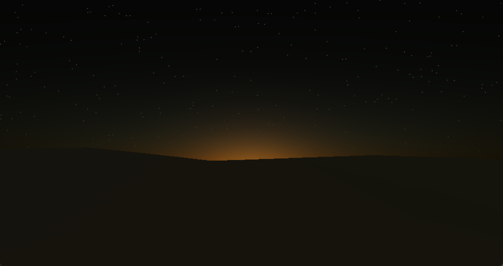
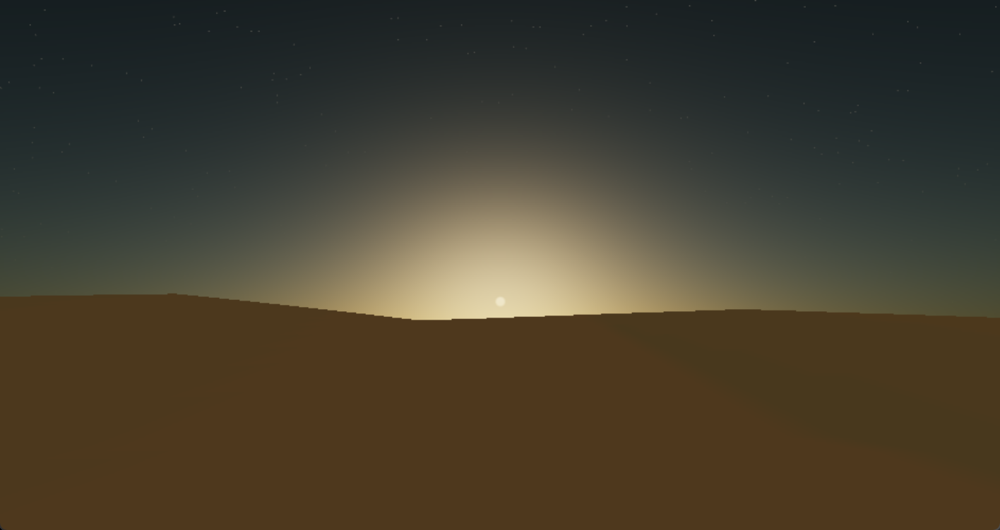
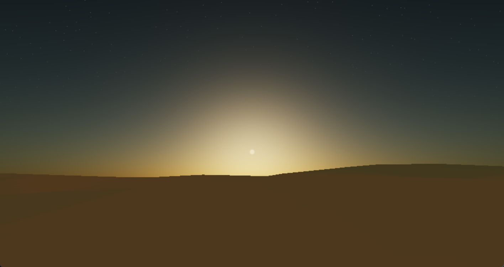
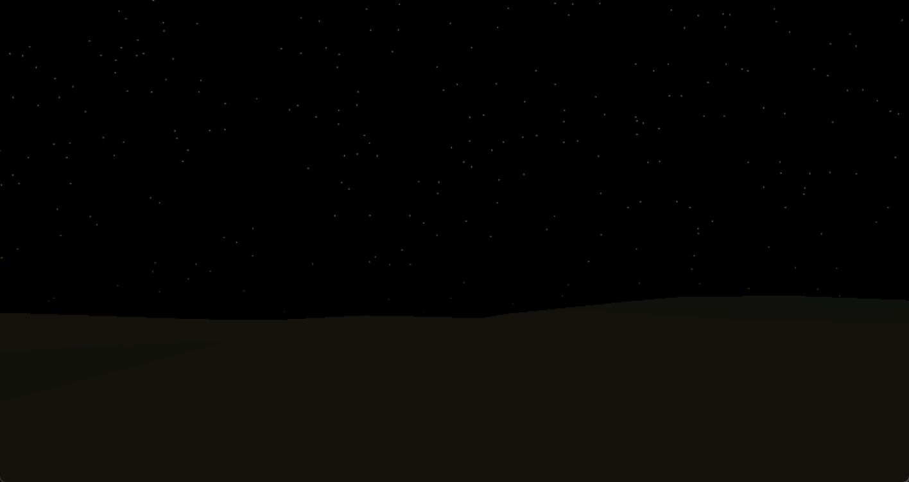

# Dawn and twilight candidate

## Scope of this qualification

The [reference measurement policy](../reference-measurement-policy.md) keeps
reference-machine runs optional for merge and explicitly unqualified preview.
Required CI, reviews, functional and safety checks still apply. The release and
production activation gates remain binding.

Start the paired Groundwork and WYU preview with
`GROUNDWORK_TWILIGHT_PREVIEW=1` in the process environment. Unset it for normal
play and Continue with the existing v1 atmosphere and lighting. `WYU_PACKAGE_G=off`
continues to control the existing sky fallback. The twilight capture and sky
measurement scripts set and restore the preview flag explicitly. Lookup and its
resource reuse remain separate diagnostic switches.

For the integrated Orbit/master candidate, renewed evidence and remaining gates,
see [combined candidate acceptance](final-acceptance.md). Captures and raw logs
below retain their original source identities; they do not certify a later merge.

These are unretouched captures of the seed-42 disposable WYU reference-world
fixture. BMP captures were converted losslessly to PNG. Matching JSON files
record canonical eye/view, solar elevation, clock sample, weather opacity and
profile identities. The camera stays fixed within each sunrise/sunset sequence.

## Approved appearance

The owner approved the captured TW1 colour treatment, TW2 night-strength floor
and TW3 visual adoption on Continue on 20 November 2026. The new appearance
applies on Continue when the preview is explicitly enabled. Package, reference
and handoff release gates remain open.

Predawn, with a localized warm horizon:

Sunrise, with warmer low-angle light below a cooler upper sky:

Sunset and fading evening twilight:

Full night remains darker, with distinct stars:

## Reproduction and evidence limits

- Windows x64 Release, NVIDIA RTX PRO 5000 Blackwell Generation Laptop GPU,
  driver 32.0.15.9653, Debug Layer and DRED enabled.
- Native render extent: 944 × 501. The physical client captures are
  1416 × 752 at desktop scaling. They are not 1080p performance measurements.
- WYU client DLL SHA-256 at capture:
  `586AA6BC53B4B5B195FEF741521C05EA3FBA1AD6EE7D432C3361C5033D26A728`.
- The approved package pin was retained. Only the local D3D12 renderer DLL
  was replaced for this isolated comparison, built from the source delivered
  by [Groundwork PR #193](https://github.com/DaveBeusing/Groundwork/pull/193).
  Renderer DLL SHA-256:
  `7F19635B83B7BC214E4BBA239669BD76A74ABDCD1D461D98C49DA4796E3444B5`.
- `eng/Test-ReferenceTwilight.ps1 -Adapter hardware -OutputDirectory <directory>`
  completed all 290 acknowledged presentations. The accepted environment tick
  and terrain publication remained unchanged. Native shutdown reported one
  warning, zero errors/corruption/discarded diagnostics and zero live children.
  The warning's ID/text was not retained by the existing severity-only report;
  this is not a claim of warning-clean execution.
- Earlier white/overlapped or wrongly cropped desktop captures were rejected.
  The retained set uses explicit logical-to-physical client-coordinate
  conversion. No foreign window content is included in these images.

This validates the candidate presentation and its local API-compatible engine
integration. It does not establish a newly published immutable package,
reference-class GPU/CPU/Present timings, full pressure acceptance, or detailed
night traversal readability in a representative textured scene. Seven
checkpoints per sequence are not an independent frame-by-frame flicker audit.

## Additional handoff qualification

**PASSED — local candidate hardware route, 20 November 2026.** The repaired
capture fixture completed `eng/Test-ReferenceSky.ps1 -Adapter hardware` for
seeds 42 and 20261111, each with flight and fresh-process Continue. All twelve
horizon/sun/star comparisons across both ownership transitions reported zero
differing RGB channels. The full-image RGB tolerance and one-pixel solar
centroid limit remain unchanged. The landed sky/clock/pose line matched on
Continue for each seed. Final shutdown reported zero errors, corruption,
discarded diagnostics and live children. Intermediate handoffs retained only
their documented shared queue. Warning counts were 11/12 on the flight runs
and one on each Continue run; individual warning identities were not retained.

The earlier failures were genuine fixture problems: rounded client corners
included desktop pixels, and mixing caller-DPI coordinates with another
logical-to-physical conversion caused false obstruction/crop results. The
fixture retains temporary square corners and now scopes capture operations
to Per-Monitor V2, validates actual client bounds and restores thread context
afterwards. Neither failure is counted as a pass, and no image threshold was
relaxed to obtain the successful run.

The retained final [raw log](handoff-20261120.log) has SHA-256
`0F8324EA436994357699F350C73DD3ADF7818407341C3FE756C4217A81164ED5`.
Source blobs were `50b2dfa3e528ce9eae01001aee5dcbf38f5face0`
and `a96665f325bedcc0f9b4c37072735514fedb6ce8` for the two capture files. The
tested client DLL SHA-256 was
`5F2CB4515B1B6F48B19939791565D4F576EE8BA7F65D8C38747524D7954B129B`,
and the isolated candidate renderer was
`DCB5EC81EB1D4F5775BCD9F497E5CF5C5BD6A45E720504514EC245EB9FA349BA`.
Independent code review verified the source and all twelve log results.

This closes the local functional handoff/Continue blocker. It does not replace
the master-produced immutable package pin, installed-archive replay, reference
hardware performance, or integrated pressure qualification.

## Prepared reference measurement

For production qualification, use the [reference runbook](reference-qualification.md)
on the accepted i9-10850K / RTX 5070 machine or with an accepted representative
setup under the reference measurement policy. It separates the synthetic renderer
pass fixture from the real WYU profile and paired native handoffs. The scripts
retain raw samples, failures and exact denominators; smoke execution does not
approve a budget. Source/assembly hashes, clean-source checks and fresh output
directories are required in full mode. The production package guards remain
unchanged.

The [TW1–TW3 decisions](../package-g-sky.md#owner-decisions-for-the-paired-prs)
were approved by the owner on 20 November 2026. Existing gameplay timing and save payloads are
unchanged. Existing saves adopt the new look in this candidate; no player save
was opened or modified to produce these captures.
