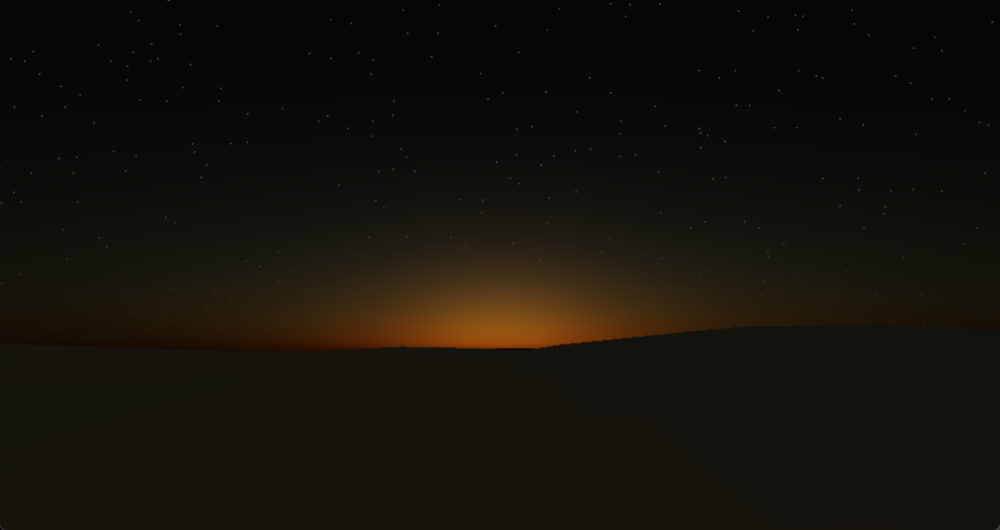

# Dawn and twilight candidate

These are unretouched captures of the seed-42 disposable WYU reference-world
fixture. BMP captures were converted losslessly to PNG. Matching JSON files
record canonical eye/view, solar elevation, clock sample, weather opacity and
profile identities. The camera stays fixed within each sunrise/sunset sequence.

## Proposed appearance

Predawn, with a localized warm horizon:

Sunrise, with warmer low-angle light below a cooler upper sky:

Sunset and fading evening twilight:

Full night remains darker, with distinct stars:

## Reproduction and evidence limits

- Windows x64 Release, NVIDIA RTX PRO 5000 Blackwell Generation Laptop GPU,
  driver 32.0.15.9653, Debug Layer and DRED enabled.
- Native render extent: 944 × 501. The physical client captures are
  1416 × 752 at desktop scaling. They are not 1080p performance measurements.
- WYU client DLL SHA-256 at capture:
  `586AA6BC53B4B5B195FEF741521C05EA3FBA1AD6EE7D432C3361C5033D26A728`.
- The approved package pin was retained. Only the local D3D12 renderer DLL
  was replaced for this isolated comparison, built from the source delivered
  by [Groundwork PR #193](https://github.com/DaveBeusing/Groundwork/pull/193).
  Renderer DLL SHA-256:
  `7F19635B83B7BC214E4BBA239669BD76A74ABDCD1D461D98C49DA4796E3444B5`.
- `eng/Test-ReferenceTwilight.ps1 -Adapter hardware -OutputDirectory <directory>`
  completed all 290 acknowledged presentations. The accepted environment tick
  and terrain publication remained unchanged. Native shutdown reported one
  warning, zero errors/corruption/discarded diagnostics and zero live children.
  The warning's ID/text was not retained by the existing severity-only report;
  this is not a claim of warning-clean execution.
- Earlier white/overlapped or wrongly cropped desktop captures were rejected.
  The retained set uses explicit logical-to-physical client-coordinate
  conversion. No foreign window content is included in these images.

This validates the candidate presentation and its local API-compatible engine
integration. It does not establish a newly published immutable package,
reference-class GPU/CPU/Present timings, full pressure acceptance, or detailed
night traversal readability in a representative textured scene. Seven
checkpoints per sequence are not an independent frame-by-frame flicker audit.

## Additional handoff qualification

The final two-seed desktop handoff/Continue qualification is **BLOCKED**, not
passed. The first full-image comparison found differences only in the rounded
bottom client corners; the solar centroid itself was unchanged. The same
failure occurred with the unchanged approved renderer. A bounded raw-BMP
comparison found 23 differing RGB pixels, all in the bottom six rows at the
extreme corners, confirming desktop contamination outside the rendered sky.

The disposable capture fixture now requests square Windows 11 client corners
and restores the prior preference on disposal. A subsequent attempt was
rejected by its unobstructed-window check because a sampled client point
belonged to another process. Repeat this qualification on an unobstructed
desktop. Full-image RGB and one-pixel solar-centroid assertions remain
unchanged; neither the failed comparison nor the rejected capture counts as
passing evidence.

The [TW1–TW3 decisions](../package-g-sky.md#owner-decisions-for-the-paired-prs)
remain pending owner approval. Existing gameplay timing and save payloads are
unchanged. Existing saves adopt the new look in this candidate; no player save
was opened or modified to produce these captures.
