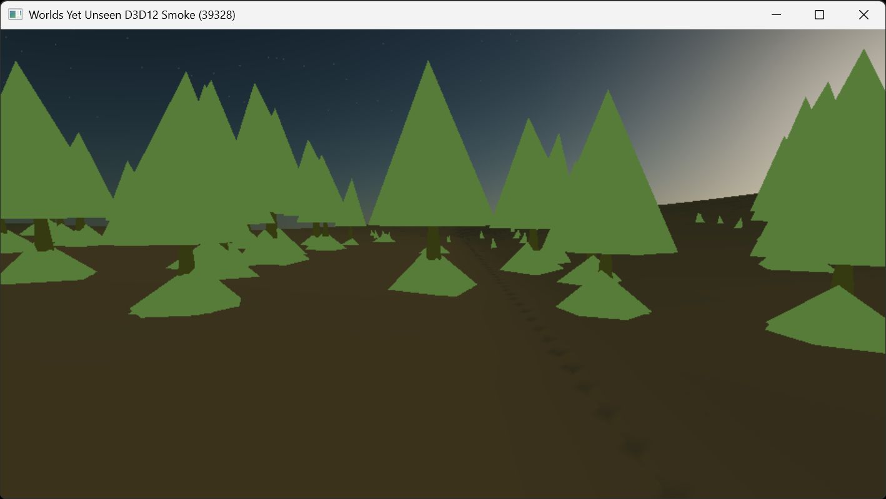
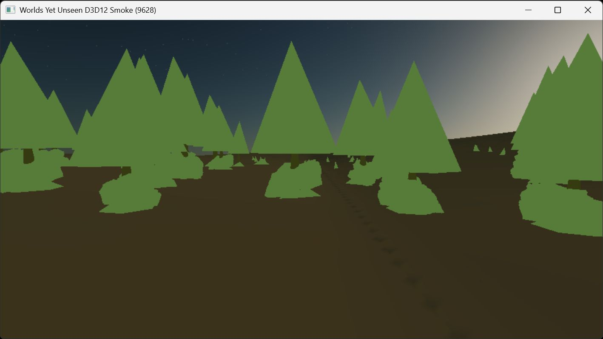

# Orbit demo

In Free Test World, choose **New Orbit Demo**. The preview uses seed 42, the existing Far Horizon terrain and prop placement, a fixed initial camera pitch of −0.12 radians, and sunset at environment tick 9000. It stores the presentation profile in the slot marker `WYUVOL04`. Terrain recipe, descriptor and checkpoint layout are shared with the existing Far Horizon profile.

The concept reference is the owner's `GroundworkEngine-Media-Kit/banners/groundworkengine-github-banner.png`, SHA-256 `4d1e370890a02c18a5d8d8a156abfe096a7aeab68417de34618c122b7c015cda`.

The offline [Toposcope Sunset reference](https://polyhaven.com/a/toposcope_sunset) informs the low warm sun and cool ambient light. The initial planet-relative direction is normalized from (0.68, 0.18, 0.70). Near terrain receives warm direct and cool ambient light through WP15. The orbit proxy uses a tint derived from the same sun and local radial normal. The atmosphere keeps the same sun direction on both renderers. The HDRI is absent from the runtime payload.

The boulder substitutes the existing rock archetype while preserving placement, IDs, culling radius, 128 m range, and LOD hysteresis. The two embedded meshes share the same source pivot. Set `WYU_ORBIT_BOULDER=off` before launching to compare the existing rock mesh with the same scene and lighting. The CC0 asset manifest and cooking recipe are in [Assets/OrbitDemo](../../src/WorldsYetUnseen.Client/Assets/OrbitDemo/manifest.json) and [the asset cooker](../../eng/Cook-OrbitDemoAssets.ps1).

## Remaining work for #67

The Orbit Demo binds Rock 01 to basalt and Rocks Ground 05 to ochre stone on the surface and the orbital proxy. The PBR provider is pinned to the [immutable Groundwork package archive](https://github.com/DaveBeusing/Groundwork/releases/tag/archive-groundwork-0.1.0-dev.44510519303.1-immutable-complete) built from Groundwork master `067bb61`. Surface textures begin at mip 2 and can promote to mip 0. The orbital proxy stays at mip 2. If geometry exceeds the existing appearance budget, the surface keeps its biome-color fallback.

If a bundled terrain texture fails validation, the Orbit Demo reports the affected asset and opens with base colors. A scripted PBR measurement stops on the same validation error so its results identify a valid textured run.

Use `WYU_ORBIT_PBR=off` to compare the same scene with its previous material path. The [1080p validation runner](../../eng/Measure-OrbitTerrainPbr.ps1) can exercise baseline, terrain-only, boulder-only, and combined variants on the same build. It records renderer-receipt timings and texture diagnostics. Those observations do not establish GPU execution time or display presentation intervals.

Landform and conifer composition tuning, the other two camera viewpoints, and the final installed reference acceptance remain open. Workstation smoke and images give review evidence for the preview. The approved reference protocol requires the designated WP11 reference machine, four asset configurations, five matched pairs, at least 2,000 frames per phase, and the checks in [WYU #67](https://github.com/DaveBeusing/wyu/issues/67).

## Workstation A/B timing

Five off/on pairs, alternating order, passed the entire 480-tick seed-42 route. Each run discarded 40 warm-up frames, leaving 2,200 measured frames per variant overall. Both variants used the same preview build and scene, with WP15 shadows, WP16 props, fog and sky enabled. The only A/B change was the rock mesh. Each run reported two terrain windows, three views, eight peak total prop draws, 179 peak visible instances and zero prop payload uploads for the camera-only sweep.

The workstation was running Windows x64 Release with an NVIDIA RTX PRO 5000 Blackwell Generation Laptop GPU, driver `32.0.15.9653`. The native render extent was **944 × 501**. The measured client DLL SHA-256 was `dc18019002124d5fa6b4033fd8ebd71f196d75e832e95afdee5df1bcccaad929`. It used the runtime changes in `2119a9f` with the screenshot hold disabled. Run `dotnet <client.dll> --volume-smoke 42 hardware` with `WYU_ORBIT_DEMO_SMOKE=1`, `WYU_WP13_MEASURE=on`, `WYU_WP15=on`, `WYU_WP16_SMOKE=1`, `WYU_PACKAGE_E=on`, `WYU_PACKAGE_G=on`, `WYU_ORBIT_CAPTURE` unset, and `WYU_ORBIT_BOULDER=off` or `on`.

| Host-observed metric | Existing rock | Boulder 01 |
| --- | ---: | ---: |
| Submit to renderer receipt p50 | 16.529 ms | 16.559 ms |
| Submit to renderer receipt p95 | 18.004 ms | 17.981 ms |
| Submit to renderer receipt p99 | 61.530 ms | 25.316 ms |
| Worst submit to renderer receipt | 461.343 ms | 484.278 ms |
| Receipt interval p99 | 268.771 ms | 263.964 ms |
| Worst receipt interval | 1,497.221 ms | 1,591.154 ms |

Individual pairs differed substantially. Boulder 01 had the higher submit-to-receipt p99 in the first two pairs and the lower p99 in later pairs. Pooling therefore does not establish a reproducible improvement. The route intentionally minimizes and restores the window around step 120. Those observations remain in the raw data and are also listed separately. CPU execution, GPU execution, display presentation, incremental texture GPU backing, and approved reference acceptance remain unmeasured. Separate Debug Layer/DRED capture replays with both rock variants reported 492 warnings each and zero errors, corruption, discarded messages or live children.

[Recipe and assembly hash](evidence/workstation-recipe.json) · [Run status](evidence/workstation-runs.csv) · [Raw QPC samples](evidence/workstation-samples.csv) · [Summary](evidence/workstation-summary.csv) · [Restore-adjacent samples](evidence/workstation-restore-adjacent.csv)

## Workstation screenshots

Both D3D12 window captures use the same confirmed frame at scripted step 100, with 171 visible props. The player foot is `(16.00020, 4103.98545, 22.66020)`, world tick 101, environment tick 9100, origin revision 2, camera yaw 0, pitch −0.12 rad and vertical FOV 1 rad. The capture DLL SHA-256 is `6eaa426125973efcace315e5a43b7fe96ae23e5546d6959445a993fa8db12e35`. The JPEGs are 1418 × 799 window captures including the title bar. To replay this viewpoint use the same environment as the timing run, unset `WYU_WP13_MEASURE`, and set `WYU_ORBIT_CAPTURE=1`.

| Existing rock mesh | Boulder 01 |
| --- | --- |
|  |  |

The boulder silhouettes differ at the same placements. The current terrain color, conifer density and skyline still differ from the concept image. These captures cover the boulder comparison and do not establish the banner composition or installed visual acceptance.
