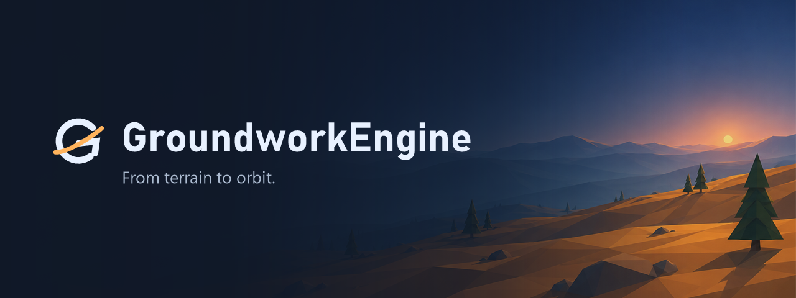

# Orbit demo

In Free Test World, choose **New Orbit Demo**. The preview uses seed 42, the existing Far Horizon terrain and prop placement, a fixed initial camera pitch of −0.12 radians, and sunset at environment tick 9000. It stores the presentation profile in the slot marker `WYUVOL04`. Terrain recipe, descriptor and checkpoint layout are shared with the existing Far Horizon profile.

The concept reference is the owner's `GroundworkEngine-Media-Kit/banners/groundworkengine-github-banner.png`, SHA-256 `4d1e370890a02c18a5d8d8a156abfe096a7aeab68417de34618c122b7c015cda`.

The offline [Toposcope Sunset reference](https://polyhaven.com/a/toposcope_sunset) informs the low warm sun and cool ambient light. The initial planet-relative direction is normalized from (0.68, 0.18, 0.70). Near terrain receives warm direct and cool ambient light through WP15. The orbit proxy uses a tint derived from the same sun and local radial normal. The atmosphere keeps the same sun direction on both renderers. The HDRI is absent from the runtime payload.

The boulder substitutes the existing rock archetype while preserving placement, IDs, culling radius, 128 m range, and LOD hysteresis. The two embedded meshes share the same source pivot. Set `WYU_ORBIT_BOULDER=off` before launching to compare the existing rock mesh with the same scene and lighting. The CC0 asset manifest and cooking recipe are in [Assets/OrbitDemo](../../src/WorldsYetUnseen.Client/Assets/OrbitDemo/manifest.json) and [the asset cooker](../../eng/Cook-OrbitDemoAssets.ps1).

## Remaining work for #67

The Rock 01 and Rocks Ground 05 maps are cooked and their hashes are recorded. Binding them to runtime terrain requires a Groundwork change. The pinned engine offers the fixture paths from [INT-01](https://github.com/DaveBeusing/Groundwork/issues/162) and [TEX-03](https://github.com/DaveBeusing/Groundwork/issues/161). WYU uses a shared D3D12 session, biome-aware volume packing and a static globe mesh. Production integration needs opt-in PBR appearance on that session-backed near path and a corresponding canonical material binding on the shared orbit path. Validate texture reuse across generation changes and packing within the existing WP11 credits. Keep the current texture fallback and protected movement/edit order when testing mixed demand.

Landform and conifer composition tuning, the other two camera viewpoints, and the final installed reference acceptance remain open. Workstation smoke and images give review evidence for the preview. The approved reference protocol requires the designated WP11 reference machine, four asset configurations, five matched pairs, at least 2,000 frames per phase, and the checks in [WYU #67](https://github.com/DaveBeusing/wyu/issues/67).
